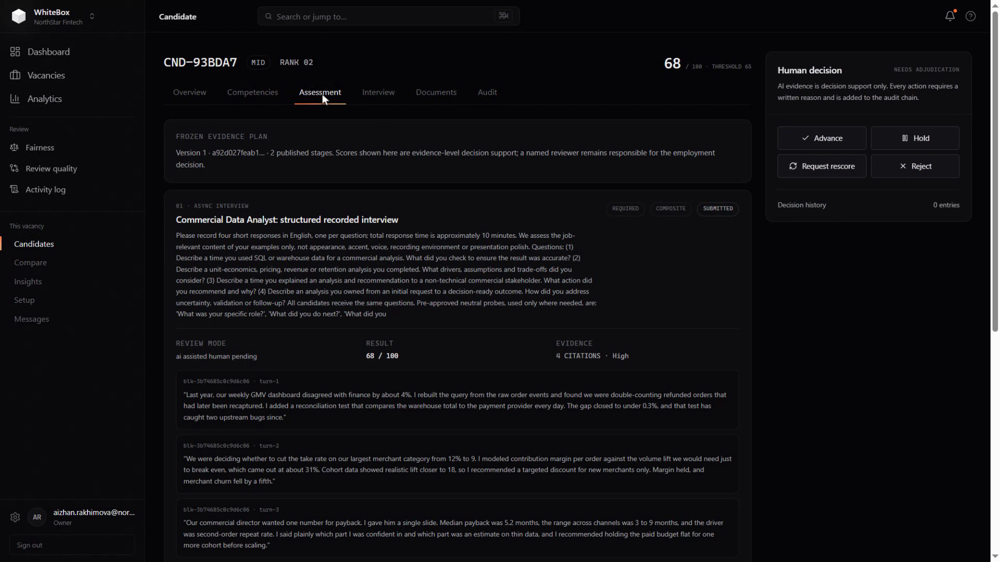
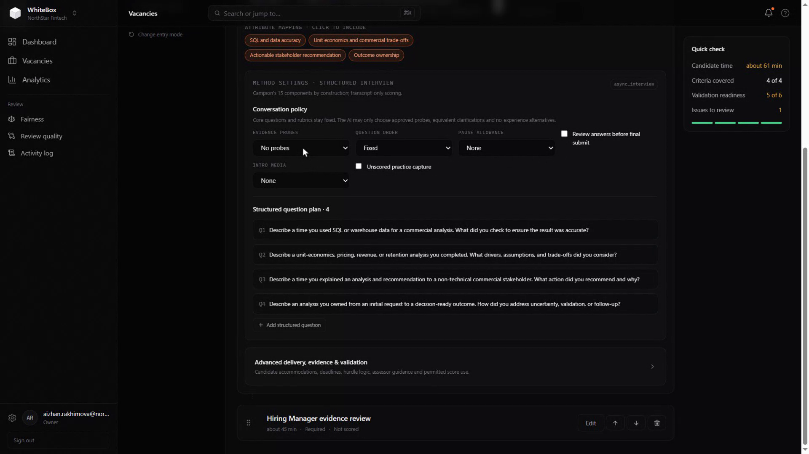
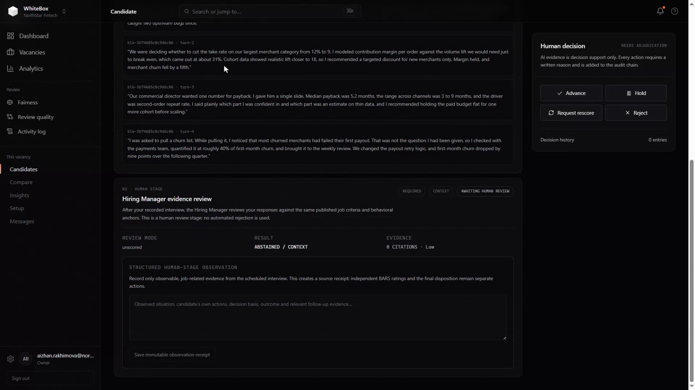
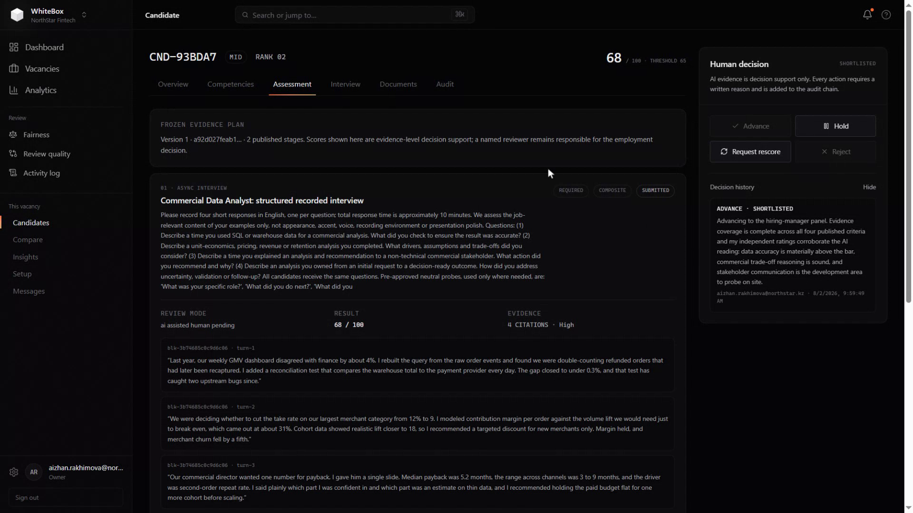

# WhiteBox AI
### A score should lead back to evidence.

A hiring-assessment workspace in which the job criteria, candidate evidence, scoring rubric and human decision remain connected. The central object is a **published, versioned assessment plan**, not a free-form conversation with a model.



*Assessment review in the synthetic NorthStar demo workspace: a frozen plan, cited evidence and a separate human decision panel.*

**QwertyS · National Founder Cup participation · development paused**

[Watch the recorded development-demo walkthrough](docs/portfolio/media/whitebox-demo.mp4) ·
[Read the competition pitch deck](docs/portfolio/media/WhiteBoxAI-NFC-2026.pdf) ·
[Competition and version record](docs/portfolio/HACKATHON.md)

## Fix the criteria before reviewing the answers

An assessment is difficult to audit when questions, weights or evaluation criteria quietly change between candidates. WhiteBox starts with the vacancy: job analysis, criteria, evidence methods, stages, behavioural scoring anchors, weights and governance are assembled before publication.

Publishing freezes that configuration into a version. Candidate submissions and later reviews stay attached to the exact version they used. A score can therefore be interpreted against the rubric that actually existed at the time, rather than against the latest edited vacancy.



*The vacancy studio connects criteria to the structured question plan and exposes checks before publication.*

## A candidate journey with explicit boundaries

The candidate opens an invitation, reviews the notice and completes the published stages. For recorded answers, the browser supports local capture, review and re-recording before the candidate chooses to use the recording. A text-only accommodation follows the same questions and rubric.

The recording and the transcript have different jobs. Video provides material for an authorized reviewer; the scoring input is the approved transcript plus the published rubric. The implementation does not use appearance, gaze, emotion, accent or personality inferred from the camera as scoring features.

### A correction must not silently rewrite the evidence

The provider transcript is retained as an immutable original, with a hash recorded in its receipt. A candidate correction is stored separately with its reason and change information. Corrected or manually supplied text needs human verification against the clip before it can be used for scoring. This keeps accessibility and correction support compatible with an inspectable evidence trail.

## Review the answer behind the number

The review screen shows the assessment stage, its state, the reported score and the supporting citations together. A reviewer can inspect the exact answer passages rather than accepting a generic paragraph explaining why an applicant is “a strong fit.” Human-stage observations are recorded separately from a final disposition.



*Answer excerpts sit beside the human review workflow. All company, reviewer and candidate records shown are demonstration data.*

The reviewer can advance, hold, request a rescore or reject. Each action requires a written reason and is appended to the audit history. The UI keeps that accountable human action separate from the model-assisted assessment output.



*A recorded demonstration decision: the rationale remains visible alongside the same frozen assessment and citations.*

## How the application is organized

~~~mermaid
flowchart LR
 A[Job analysis and rubric] --> B[Frozen vacancy version]
 B --> C[Candidate stages]
 C --> D[Private recording and transcript receipt]
 D --> E[Verified evidence]
 E --> F[Rubric-based review and citations]
 F --> G[Named human decision]
 B --> H[Audit trail]
 D --> H
 G --> H
~~~

The working application uses **Next.js and PostgreSQL**, private S3-compatible recording storage, server-side media validation and model-backed transcription/evidence review. Playback passes through an authenticated, tenant-scoped API. Provider keys and storage credentials stay on the server.

Several engineering choices make failure explicit. New AI-required vacancy versions do not quietly substitute fabricated deterministic answers if a provider is unavailable. Recording validation checks both the declared media type and a decodable file. Retention is a stateful workflow that tracks metadata removal separately from object deletion, including retries when storage deletion fails.

## What this case study demonstrates

The screenshots document the authoring → evidence review → human decision path in a synthetic demonstration workspace. They establish an implemented workflow, not measured hiring validity, legal compliance or a proven reduction in bias. A real deployment still requires validated assessment methods and operational controls around access, retention and candidate notices.

The product’s distinctive engineering question is how to keep an AI-assisted assessment inspectable after the answer, rubric and reviewer have all changed over time. Version binding, separate correction records and evidence citations are the mechanisms used to answer it.


## From competition prototype to a paused project

WhiteBox AI was prepared for the **National Founder Cup 2026** startup competition.
The event is named in the retained pitch deck and presentation materials. The team
reports that it did not receive a prize and subsequently paused development. The
working prototype and engineering record remain useful as a completed exploration
of evidence-based hiring workflows; paused development is its current status.

The [competition record](docs/portfolio/HACKATHON.md) links the organizer's event information
and separates that context from the team's own participation record. The original
deck and demo can also be found in the source repository's `pitch-deck-demo-video`
branch, when access is available.

### The gallery and source have identifiable versions

The screenshots show the later assessment-studio development build with synthetic
demonstration data. That working Next.js studio is now included in this repository.
It was imported from the `p0-p1-build` branch of the Eye172 project copy; the original
public history and its earlier gallery are preserved. The video included here is the retained local
development-demo walkthrough, rather than a new live hiring session.

The Eye172 copy retains older prototype iterations on its `master` and pitch
branches. In this repository, `main` contains the later studio. The
[archived early overview](docs/archive/README-early-snapshot.md) records what the
public repository contained before this publication; its planned stack is historical.

## Run the studio locally

Use **Node.js 24** and npm. The isolated development workspace uses synthetic
records and local persistence; PostgreSQL and private S3 storage are the production path.

```sh
npm ci
```

Create `.env.local`:

```dotenv
NODE_ENV=development
NEXT_PUBLIC_APP_URL=http://localhost:3100
WBX_DEMO_MODE=true
```

```sh
npm run dev -- --port 3100
```

Open `http://localhost:3100`. Demo HR: `admin@whitebox.local` / `WhiteBox!2026`;
candidate codes: `WBX-3N8D` and the already-submitted `WBX-7Q4K`.
These are intentionally public fixture credentials, not production access.
New AI-authored assessments require a server-side provider key; the fixture
workspace has a separate deterministic compatibility path.

The [development guide](DEVELOPMENT.md) explains the complete candidate journey,
transcript verification, test commands and routes. [DEPLOYMENT.md](DEPLOYMENT.md)
and [SECURITY.md](SECURITY.md) document PostgreSQL, storage, retention and the
deployment boundary. Application code is in `app/` and `lib/server/`; ordered
schema migrations are in `db/migrations/`; automated tests are in `tests/`.

```sh
npm run check
```

[Source publication record](docs/SOURCE-PUBLICATION.md) identifies the imported
version and distinguishes this new publication commit from the original shared development.


---

### QwertyS

Jointly developed by **[Nurkhan Aimukatov / pip00sya](https://github.com/pip00sya)** and
**[Shakhnazar Akhmer / Eye172](https://github.com/Eye172)**.
Both are Full-stack, Software and AI Engineers; Shakhnazar also works in ML engineering.
Our shared experience includes product design, application development, AI integration,
testing and preparing working hackathon submissions. We contributed as equal engineering
partners across the project.


This public implementation and project presentation are maintained on Nurkhan's account.
[Companion showcase on Shakhnazar's account](https://github.com/Eye172/whitebox-ai-showcase) ·
[Nurkhan's projects](https://github.com/pip00sya) · [Shakhnazar's projects](https://github.com/Eye172).

[Public studio implementation](https://github.com/pip00sya/whitebox-ai) · [Eye172 project copy](https://github.com/Eye172/whitebox-ai-1) (access depends on visibility).

[Hackathon record and supporting sources](docs/portfolio/HACKATHON.md) ·
[Media provenance](docs/portfolio/MEDIA.md).
